# TQMS – Checkpoint Entries

A rebuild of the **Checkpoint Entries** workflow from the Truck Queue Management System (TQMS). Gate staff register vehicles that arrive at a checkpoint, verify or reject them, issue queue tokens, record exits and void wrong entries.

The app runs on a self-contained mock backend (Next.js Route Handlers). It never talks to the production system or its database.

- System analysis: [SYSTEM_ANALYSIS.md](./SYSTEM_ANALYSIS.md)
- Screenshots and walkthrough video: [media/](./media)
- Live demo: _add Vercel URL here_

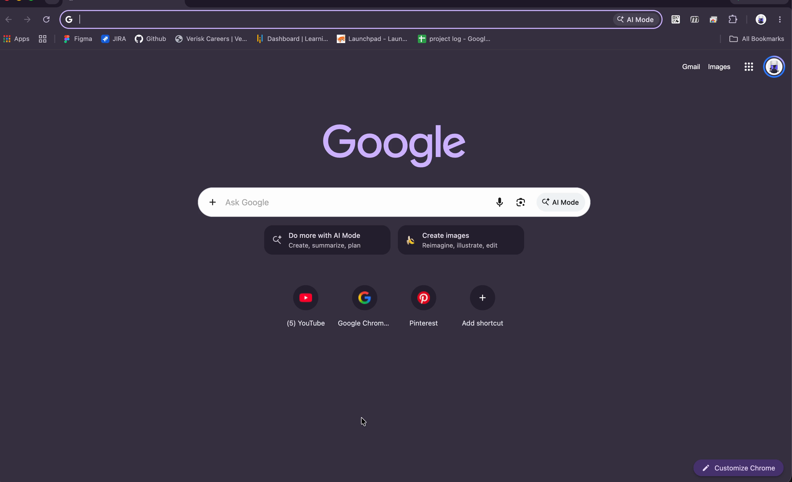

## Features

- Entry list with search, status / checkpoint / vehicle type / purpose / date filters, sorting and pagination. List state is kept in the URL, so it survives refresh and can be shared.
- Entry detail page with the vehicle, load and checkpoint information plus an activity timeline.
- Create and edit forms with client-side (Zod) validation and server field errors mapped back onto the inputs.
- Status actions: verify (issues a queue token), reject (reason required), mark exited and void (reason required), each behind a confirmation dialog.
- Status badges, breadcrumbs, toasts, loading skeletons, empty states and error states with retry.
- Responsive layout: a table on desktop, cards on tablet and mobile, and a slide-out navigation on small screens.
- Keyboard accessible: skip link, visible focus, labelled controls, focus trapped in dialogs, `aria-sort` on sortable columns.
- A **Simulate API errors** switch in the sidebar forces every request to fail, so error and retry states can be tested.

## Tech stack

| Area | Choice |
| --- | --- |
| Framework | Next.js 16 (App Router), React 19 |
| Language | TypeScript (strict) |
| Styling | Tailwind CSS v4, shadcn/ui (Base UI), Lucide icons |
| Server state | TanStack Query v5 |
| Tables | TanStack Table v9 |
| Forms | React Hook Form + Zod v4 |
| HTTP | Axios |
| Mock backend | Next.js Route Handlers |
| Toasts | Sonner |

## Getting started

Requires Node.js 20.9+.

```bash
git clone git@github.com:dineshbajgain/tqms-checkpoint-frontend.git
cd tqms-checkpoint-frontend
npm install
cp .env.example .env.local   # optional, defaults work without it
npm run dev
```

Open http://localhost:3000. It redirects to `/checkpoint-entries`.

Other scripts:

```bash
npm run build   # production build
npm start       # serve the build
npm run lint
```

## Environment

| Variable | Default | Purpose |
| --- | --- | --- |
| `NEXT_PUBLIC_API_BASE_URL` | `/api` | Base URL of the API. Change it to use a real backend. |
| `MOCK_DELAY_MS` | `600` | Average mock delay. Each response takes 50–150% of this. |
| `MOCK_FAILURE_RATE` | `0` | Probability (0–1) of a random 500 from the mock. |

## Sample credentials

None are needed. The rebuild has no login screen, and the header shows a fixed "Checkpoint User". Real TQMS credentials are not stored in this repository.

## Folder structure

```
src/
├── app/
│   ├── (dashboard)/checkpoint-entries/   # list, new, [id], [id]/edit pages
│   ├── api/                              # mock backend (Route Handlers)
│   │   ├── checkpoint-entries/           # GET, POST, [id] GET/PATCH/DELETE, [id]/status PATCH
│   │   └── lookup/[type]/                # dropdown options
│   ├── layout.tsx, providers.tsx         # fonts, QueryClient, toaster
│   └── not-found.tsx
├── features/
│   └── checkpoint-entries/
│       ├── api/          # typed API calls + query keys
│       ├── hooks/        # TanStack Query hooks, URL list params, lookups
│       ├── components/   # list, filters, columns, detail, form, dialogs
│       ├── schemas/      # Zod schemas shared by the form and the mock
│       ├── types/        # entity and request types
│       └── constants.ts  # statuses, transitions, labels
├── components/           # reusable, feature-agnostic UI
│   ├── data-table/       # DataTable, Pagination
│   ├── filters/          # SearchInput, FilterSelect, MultiSelectFilter, DateRangeFilter
│   ├── form/             # FormField, SelectField
│   ├── dialogs/          # ConfirmDialog (with optional reason)
│   ├── feedback/         # EmptyState, ErrorState
│   ├── status/           # StatusBadge
│   ├── layout/           # AppShell, SidebarNav, PageHeader
│   └── ui/               # shadcn primitives
├── lib/                  # axios client, ApiError, formatting, error simulation flag
├── mock/                 # mock data, in-memory store, services, HTTP helpers
└── types/                # shared API response types
```

Features own their API calls, hooks, schemas and components. Only feature-agnostic pieces go in `components/`, which means a second workflow (for example Queue or Exit Gate) can be added as another folder under `features/` without touching existing code.

## Mock API

All responses are JSON. Successful responses look like `{ data }`, and list responses also include `{ meta }`. Errors always use the same shape:

```json
{
  "error": {
    "code": "VALIDATION_ERROR",
    "message": "Some fields are invalid.",
    "fieldErrors": { "vehicleNo": ["Vehicle number is required"] }
  }
}
```

### Endpoints

| Method | Path | Description | Success |
| --- | --- | --- | --- |
| GET | `/api/checkpoint-entries` | Paginated, filtered, sorted list | 200 |
| POST | `/api/checkpoint-entries` | Create an entry | 201 + `Location` |
| GET | `/api/checkpoint-entries/:id` | Entry detail | 200 |
| PATCH | `/api/checkpoint-entries/:id` | Edit an entry (only while Arrived) | 200 |
| PATCH | `/api/checkpoint-entries/:id/status` | `{ action: "verify" \| "reject" \| "exit", reason? }` | 200 |
| DELETE | `/api/checkpoint-entries/:id` | Void an entry, `{ reason }` in the body | 200 |
| GET | `/api/lookup/:type` | `checkpoints`, `transporters`, `products`, `vehicle-types` | 200 |

Void is a soft delete. The entry stays in the list with the **Voided** status and its reason, so the audit trail is kept.

### List query parameters

| Param | Example | Notes |
| --- | --- | --- |
| `page`, `pageSize` | `page=2&pageSize=20` | `pageSize` is 1–100 |
| `search` | `search=ba 3 kha` | Entry no, vehicle no, driver, phone, challan, transporter. Spaces and dashes are ignored. |
| `status` | `status=arrived,verified` | Comma-separated |
| `checkpointId`, `vehicleTypeId` | `checkpointId=cp-birgunj` | Lookup values |
| `purpose` | `purpose=loading` | `loading` or `unloading` |
| `from`, `to` | `from=2026-11-01&to=2026-11-04` | Arrival date, Nepal time |
| `sort` | `sort=quantity:asc` | `entryNo`, `vehicleNo`, `quantity`, `arrivedAt`, `status` |

Example:

```bash
curl "http://localhost:3000/api/checkpoint-entries?status=arrived&sort=arrivedAt:desc&pageSize=1"
```

```json
{
  "data": [{ "id": "…", "entryNo": "CP-2611-0137", "vehicleNo": "LU 1 CHA 5471", "status": "arrived", "…": "…" }],
  "meta": { "page": 1, "pageSize": 1, "total": 13, "totalPages": 13 }
}
```

### Status lifecycle

```
Arrived ──verify──▶ Verified ──exit──▶ Exited
   │                   │
   ├──reject──▶ Rejected
   └──void────▶ Voided ◀──void──┘
```

- Editing is only allowed while an entry is **Arrived**.
- Verifying issues the next queue token (`T-NNNN`).
- A vehicle can only have one active (Arrived or Verified) entry at a time.

### Error codes

| Status | Code | When |
| --- | --- | --- |
| 400 | `BAD_REQUEST` | Invalid list query parameters |
| 400 | `INVALID_JSON` | Request body is not valid JSON |
| 404 | `NOT_FOUND` | Unknown entry id or lookup type |
| 409 | `DUPLICATE_ACTIVE_ENTRY` | Vehicle already has an active entry |
| 409 | `NOT_EDITABLE` | Editing an entry that is no longer Arrived |
| 409 | `INVALID_TRANSITION` | Action not allowed from the current status |
| 422 | `VALIDATION_ERROR` | Field validation failed (`fieldErrors` included) |
| 500 | `SERVER_ERROR` | Simulated or unexpected failure |

### Data, delays and failures

- 140 entries are seeded from a fixed random seed, so the data looks realistic and is identical on every start. They cover the last three weeks across 6 checkpoints, Nepali vehicle numbers, drivers and transporters, and a status history that matches each status.
- Data lives in memory on the server. It persists across page reloads and navigation, and resets when the server restarts.
- Every request waits around `MOCK_DELAY_MS` so loading states are visible.
- Failures can be triggered in three ways: the **Simulate API errors** switch (sends `x-mock-fail: 1`), `MOCK_FAILURE_RATE`, or real validation and business-rule errors.

## Connecting a real backend

The UI never imports from `src/mock`. It only uses the functions in `src/features/checkpoint-entries/api/entries-api.ts`, which go through the shared axios client in `src/lib/http.ts`.

1. Set `NEXT_PUBLIC_API_BASE_URL` to the backend URL, for example `https://api.example.com/v1`.
2. If the backend uses different paths or response shapes, adapt them in `entries-api.ts` only. Map the response to the existing `CheckpointEntry` / `PaginatedResponse` types there.
3. If the backend uses a different error body, adjust the response interceptor in `src/lib/http.ts` so it still produces an `ApiError` with `status`, `code`, `message` and `fieldErrors`.
4. Add auth (for example a bearer token) in the axios request interceptor.
5. Delete `src/app/api` and `src/mock`, and remove the simulate switch from `AppShell`.

Components, hooks, forms and query keys stay unchanged.

## Technical explanation

### Architecture

- The code is split by feature. Each feature folder owns its data access, hooks, schemas and components, and generic building blocks live in `components/`.
- Pages in `app/` are thin. They read route params and render a feature component.
- The Zod `entrySchema` is shared by the form and the mock service, so client and server validation follow the same rules. The form adds a small wrapper for the `datetime-local` input.
- The mock is layered like a real backend: route handler → service (validation and business rules) → in-memory store. The store sits on `globalThis` so it survives hot reloads in development.

### State management

- **Server state** lives in TanStack Query. Query keys are built by a small factory (`entryKeys.list(params)`, `entryKeys.detail(id)`). After a mutation, the response is written into the detail cache and the lists are invalidated. The list keeps previous data while a new page loads, so the table doesn't flash. 4xx errors are not retried; 5xx errors are retried once.
- **List state** (page, search, filters, sort) lives in the URL, so back/forward, refresh and shared links all work.
- **Form state** lives in React Hook Form. Server `fieldErrors` are set on the matching fields, and the first invalid field gets focus.
- **UI state** such as open dialogs and the pending action stays local in components. Nothing needs a global store.

### API design

- REST resources with the correct verbs and status codes: 201 for create, 404, 409 for business conflicts, 422 for validation errors.
- Status changes use a dedicated `PATCH /:id/status` endpoint, separate from field edits, so each transition is validated in one place. Invalid transitions return 409 and the UI refreshes the entry.
- Every error uses the same body, which the axios interceptor turns into an `ApiError`. Components only deal with one error type.

### Performance

- Search is debounced (400 ms). Lookups are cached for the session (`staleTime: Infinity`), and lists stay fresh for 30 s.
- Filtering, sorting and pagination happen on the server, so the client only ever renders one page.
- Skeletons match the final layout to avoid layout shift. Background refreshes dim the current rows instead of replacing them with skeletons.
- Columns are memoized and rows use stable ids.

## Screenshots

| | |
| --- | --- |
| Loading skeleton 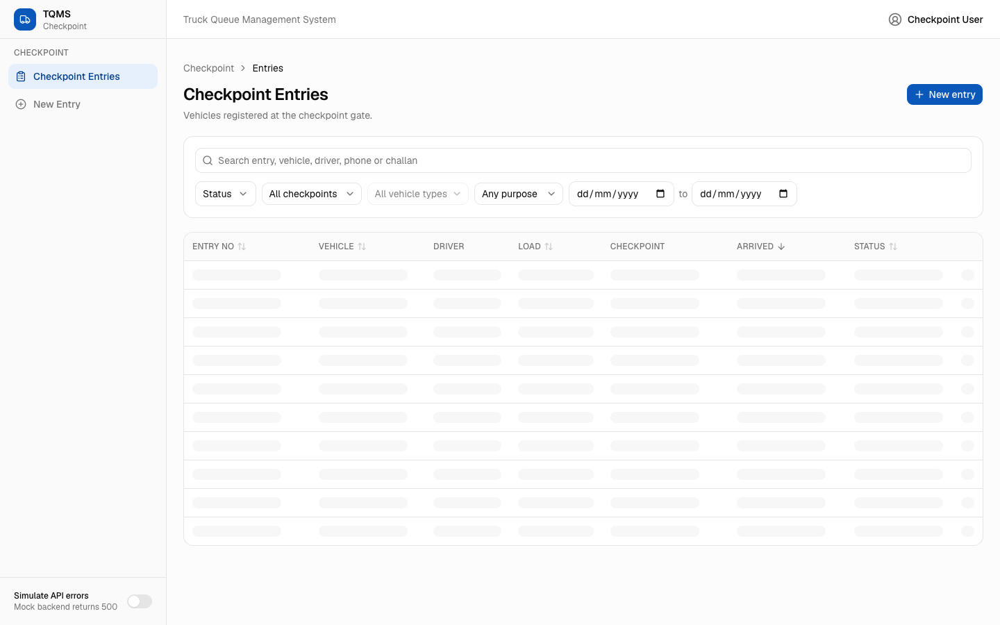 | Filters applied 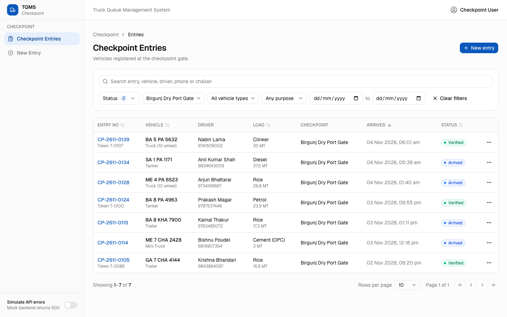 |
| No results 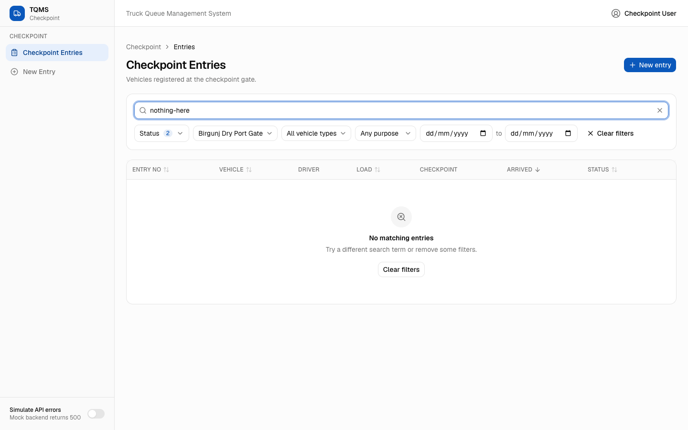 | Entry detail 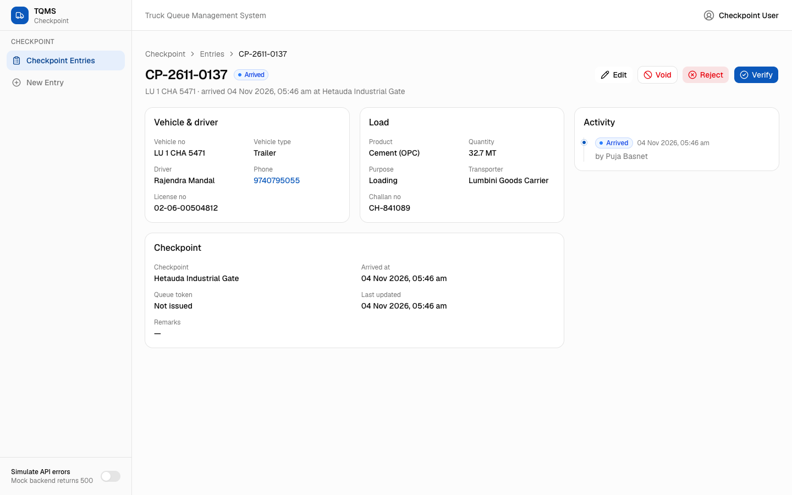 |
| Verify confirmation 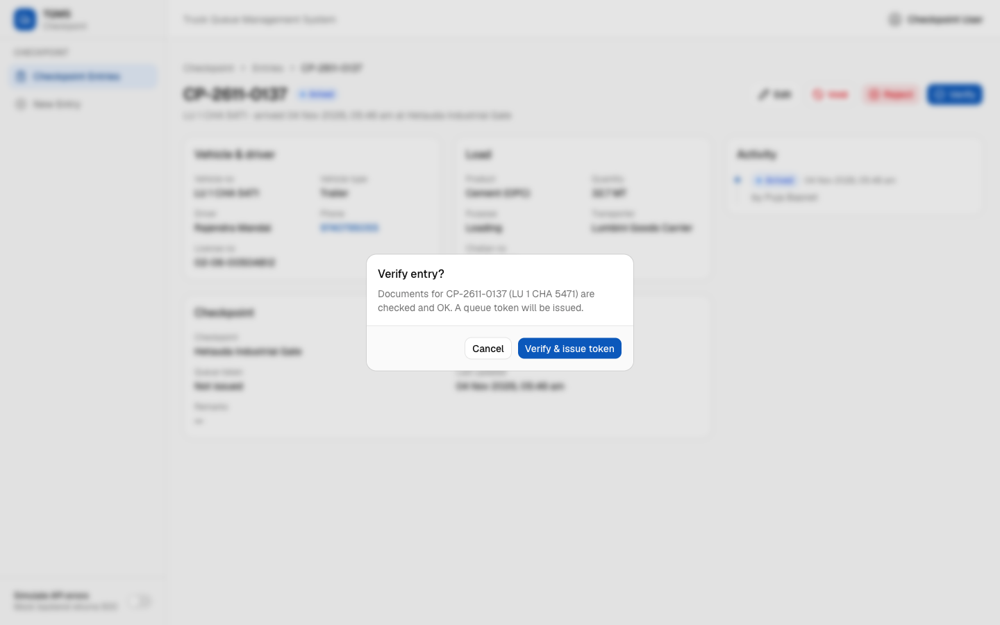 | Verified with token 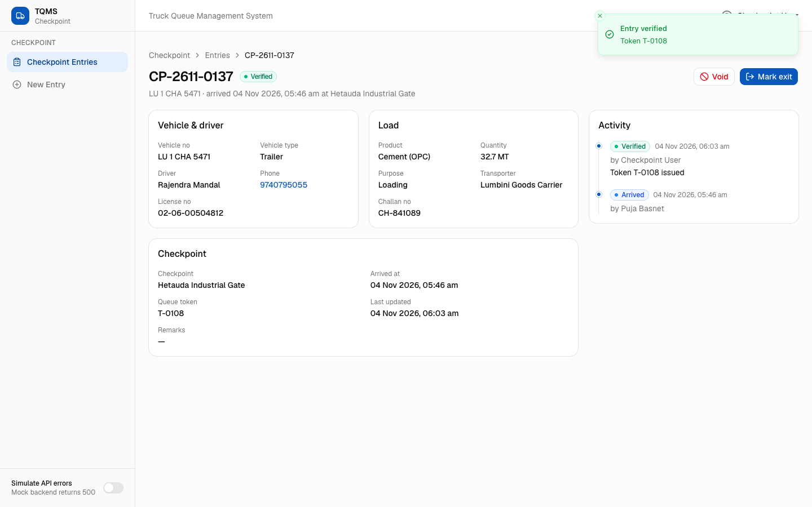 |
| Row actions 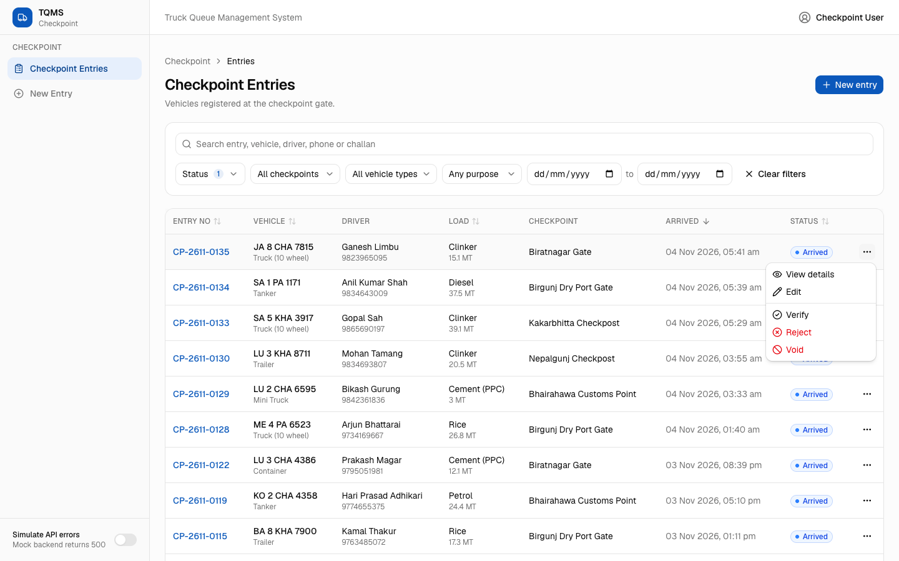 | Reject with reason 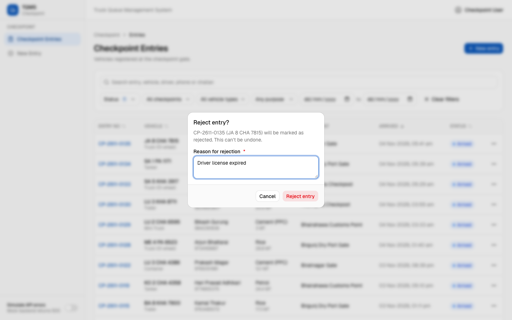 |
| Form validation 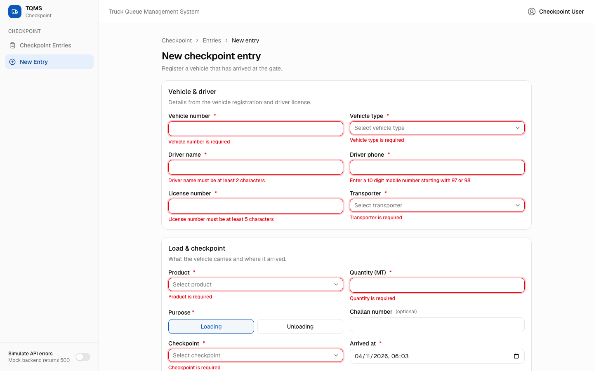 | Server field error 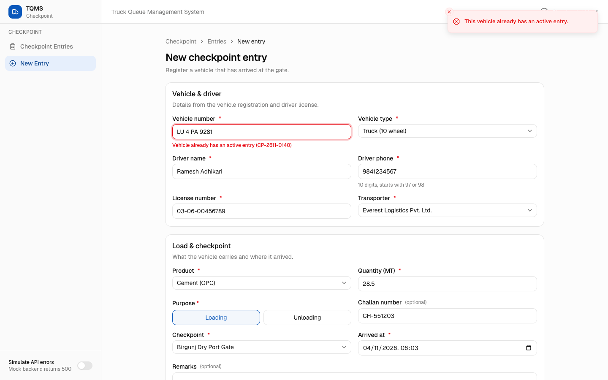 |
| Void reason required 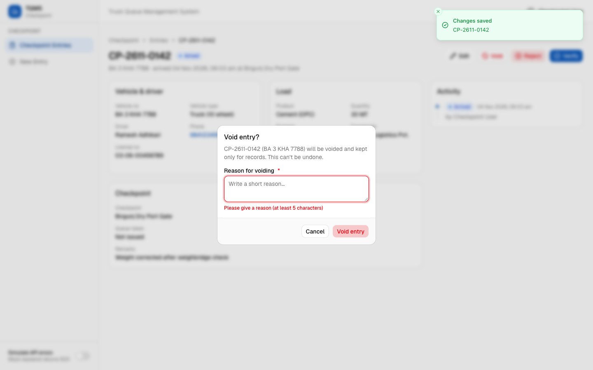 | Error with retry 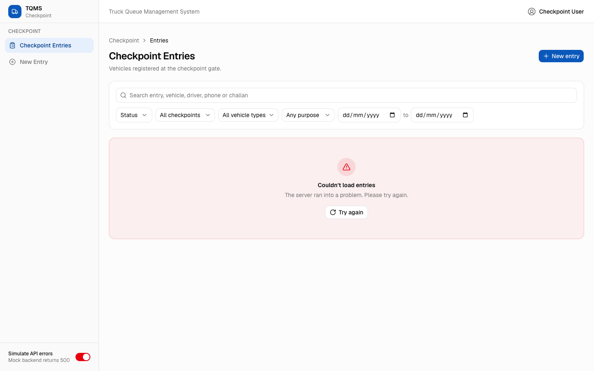 |
| Tablet 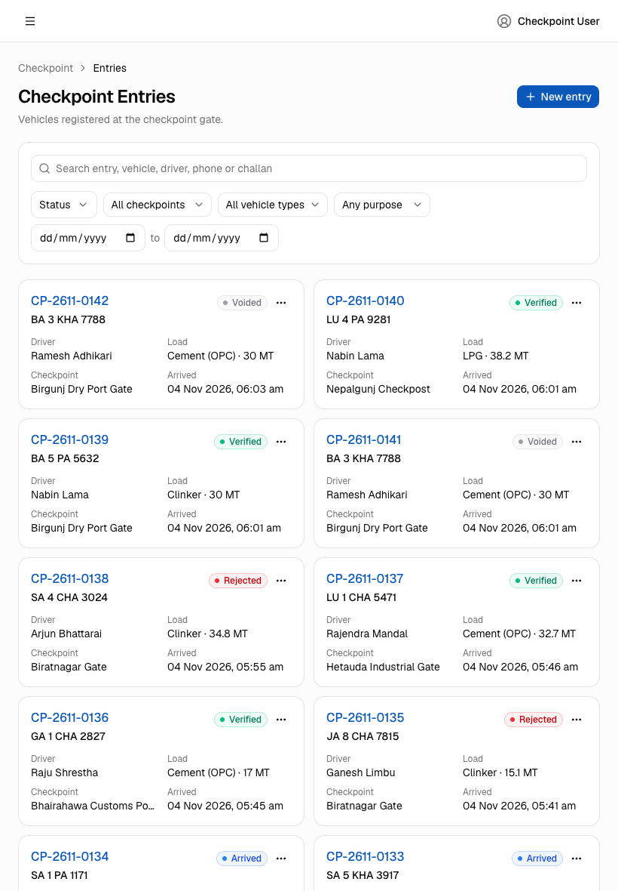 | Mobile 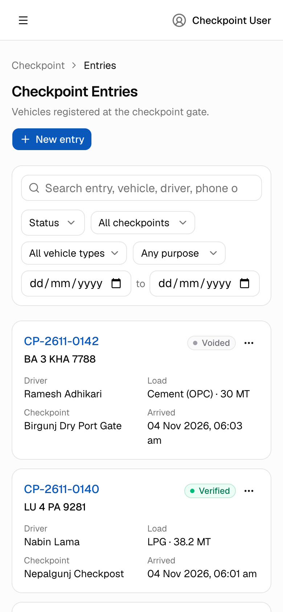 |

A full walkthrough video is in [media/walkthrough.mp4](media/walkthrough.mp4).

## Known limitations

- Mock data is in memory. It resets on restart, and on Vercel each serverless instance holds its own copy, so changes may not always be visible across requests there.
- There is no authentication or role handling. The analysis was done with a checkpoint account only.
- The workflow and its fields are based on observing the existing system without submitting real transactions, so some business rules are assumptions. These are listed in [SYSTEM_ANALYSIS.md](./SYSTEM_ANALYSIS.md).
- There are no automated tests. The flows were checked manually and with a browser script.
