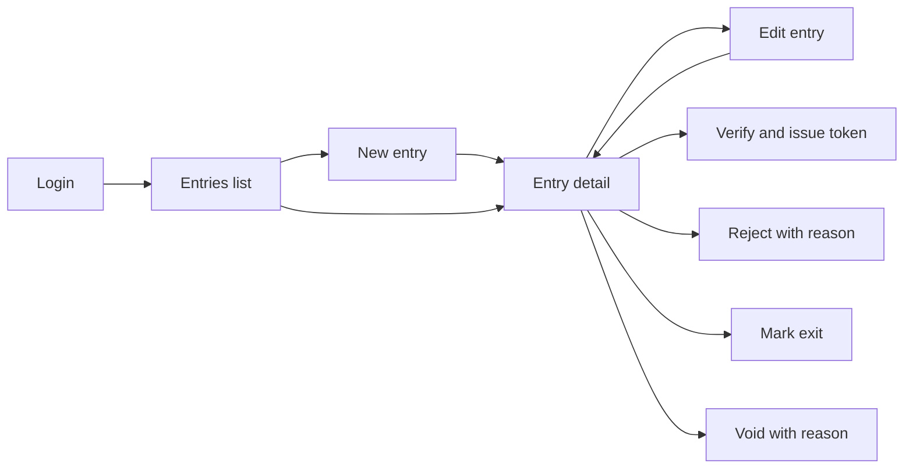

# System Analysis – TQMS Checkpoint Entries

> **Note on access:** The live reference app is at https://tqms.bitspanda.com (specifically the Checkpoint module: `https://tqms.bitspanda.com/admin/checkpoint/user`). This analysis
> covers the **Checkpoint** role's workflow (vehicle entries at a checkpoint gate) in a Truck Queue
> Management System. Anything marked _(assumed)_ was verified against the live screens with the
> checkpoint observation account.
>
> No real transactions were created, edited, or submitted on the live system.

## 1. What the existing app is

- Server-rendered ASP.NET app (IIS, jQuery, Bootstrap admin theme, SignalR).
- Login with username (email or mobile number) + password; "Forgot password" link.
- Role-based admin panel with a left sidebar. The checkpoint user only sees checkpoint-related menus.
- Time zone is Nepal Standard Time (+05:45), so all dates in the mock use that offset.

## 2. Module and submodules

| Area | Purpose |
|------|---------|
| Checkpoint Entries – list | All vehicles registered at the checkpoint, with search and filters |
| Checkpoint Entries – new | Register an arriving vehicle |
| Checkpoint Entries – detail | Full record, status history, actions |
| Checkpoint Entries – edit | Correct details while the entry is still pending verification |
| Lookups _(assumed)_ | Checkpoints, transporters, vehicle types, products |

## 3. User journey

1. Truck arrives at the gate. Checkpoint user opens **New entry** and records vehicle, driver,
   transporter, product and quantity.
2. The entry is saved as **Arrived**.
3. User checks documents (license, challan). They either **Verify** it (a queue token is issued) or
   **Reject** it with a reason.
4. When the truck leaves the checkpoint, the user marks it **Exited**.
5. A wrong entry can be **Voided** with a reason instead of being hard-deleted, so the audit trail is kept.

## 4. Status lifecycle

| Status | Meaning | Allowed actions |
|--------|---------|-----------------|
| Arrived | Registered, waiting for document check | Edit, Verify, Reject, Void |
| Verified | Documents OK, token issued, in queue | Mark exit, Void |
| Rejected | Failed document check | View only |
| Exited | Left the checkpoint | View only |
| Voided | Cancelled entry | View only |

Rules:
- Reject and Void need a reason (min 5 chars).
- A vehicle can have only **one active entry** (Arrived or Verified) at a time.
- Edit is only allowed while the entry is Arrived.
- A status change that doesn't match the table above is rejected by the server (409).

## 5. List screen

**Columns:** Entry No, Vehicle No, Vehicle Type, Driver (name + phone), Transporter, Product,
Quantity (MT), Checkpoint, Arrived At, Status, Actions.

**Search:** Entry No, Vehicle No, Driver name, Driver phone, Challan No.

**Filters:** Status (multi), Checkpoint, Vehicle Type, Purpose (Loading/Unloading), Arrival date range.

**Sorting:** Entry No, Vehicle No, Quantity, Arrived At, Status. Default: newest arrival first.

**Pagination:** 10 / 20 / 50 per page, with total count.

## 6. Form fields

| Field | Required | Rule |
|-------|----------|------|
| Vehicle No | Yes | Uppercase letters/digits, e.g. `BA 2 KHA 4521`, 6–20 chars |
| Vehicle Type | Yes | Lookup |
| Driver Name | Yes | 2–60 chars |
| Driver Phone | Yes | Nepali mobile, 10 digits starting with 97/98 |
| License No | Yes | 5–20 chars |
| Transporter | Yes | Lookup |
| Checkpoint | Yes | Lookup |
| Purpose | Yes | Loading / Unloading |
| Product | Yes | Lookup |
| Quantity (MT) | Yes | > 0 and ≤ 60 |
| Challan No | No | ≤ 30 chars |
| Arrived At | Yes | Not in the future |
| Remarks | No | ≤ 250 chars |

System fields: Entry No (`CP-YYMM-NNNN`), Token No (on verify), status timestamps, history.

## 7. UX issues observed / expected in a legacy admin panel, and what we changed

| Issue | Improvement in this build |
|-------|---------------------------|
| Full page reloads on every filter or page change | Client-side data fetching with cached results; previous page stays visible while the next one loads |
| Filters reset after viewing a record and coming back | Search, filters, sort and page are kept in the URL |
| Validation shown only after submit, at the top of the page | Inline field errors as you type/blur, plus server errors mapped back to the field |
| Destructive actions without confirmation | Confirmation dialogs; Reject/Void ask for a reason |
| Status shown as plain text | Coloured status badges and only the actions valid for that status |
| No clear loading / empty / error feedback | Skeletons, empty states, error state with Retry, toasts |
| Wide tables unusable on mobile | Card layout on small screens, sheet sidebar |

## 8. Implementation decisions

- **Next.js App Router + Route Handlers**: one repo for UI and mock API; mock routes can be replaced by
  pointing `NEXT_PUBLIC_API_BASE_URL` at the real backend.
- **Feature folder `features/checkpoint-entries`**: API calls, hooks, schemas, types and components for
  this workflow live together.
- **TanStack Query** owns server state; no global store is needed.
- **Zod schemas are shared** by the form and the mock API, so client and server validation match.
- **Void instead of delete**: `DELETE /api/checkpoint-entries/:id` changes the status to Voided, which
  matches how audit-sensitive gate records are normally handled.
